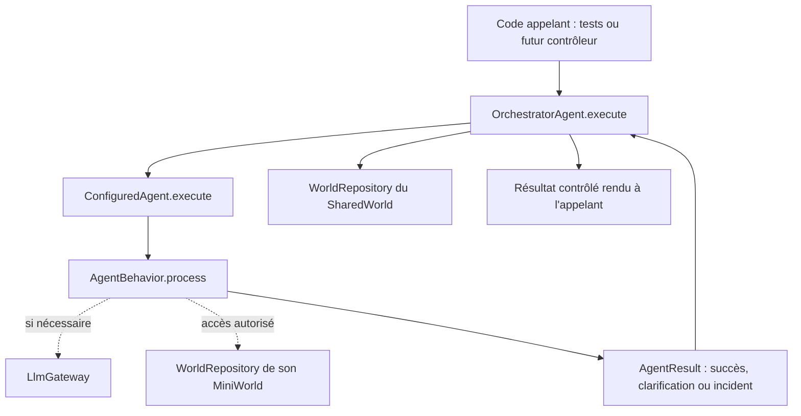

# Guide de lecture du code — MAS Email et adaptateur Ollama

Ce guide décrit les classes Java, les tests et les fichiers de configuration.
Le ParserAgent extrait le contenu de l'email, le DecisionAgent propose un
Writer d'après les profils disponibles et le Writer prépare un plan de réponse
avec les MiniWorlds fournis. Le Scribe rédige le brouillon à partir du plan
validé. Le CorrectingAgent expose un point d'injection de stratégie.

## Se repérer dans les packages

Les sources de production se trouvent dans `src/main/java/fr/mas/email/`.

| Package | Question à laquelle il répond |
| --- | --- |
| `contract` | Quelles données sont échangées et quelle structure doivent-elles respecter ? |
| `result` | Le traitement a-t-il réussi, besoin d'une clarification, ou rencontré un incident ? |
| `agent` | Qui traite les données, avec quelle configuration et quels moyens ? |
| `orchestration` | Qui autorise l'exécution d'une étape et décide si la suite peut continuer ? |
| `llm` | Comment demander une sortie structurée à un moteur sans dépendre de son implémentation ? |
| `world` | Où se trouvent l'état partagé et les connaissances privées, et comment les conserver ? |

Le schéma ci-dessous montre les appels pour **une étape**. Le contrôleur futur est
aujourd'hui remplacé par le code des tests. L'utilisation du LLM ou du MiniWorld
dépend du comportement injecté.

Le Writer ne contacte donc pas le Scribe. Une prochaine étape nécessite un nouvel
appel explicite au coordinateur. Le workflow email complet n'est pas encore assemblé.

## Quelques notions pour lire les signatures

| Notion | Signification dans ce projet |
| --- | --- |
| `record` | Objet de données dont Java génère notamment les accesseurs, `equals` et `toString`. Ici, les constructeurs vérifient les champs et copient les collections pour les rendre non modifiables. |
| DTO | Objet qui transporte des données, par exemple `EmailAnalysis`. Il ne réalise pas lui-même l'analyse. |
| `interface` | Liste d'opérations attendues d'un composant. Elle permet de changer son implémentation sans changer ses utilisateurs. |
| `I`, `O`, `T` | Paramètres de type : `I` désigne une entrée, `O` une sortie de succès et `T` un contenu quelconque mais précisément typé. |
| `sealed interface` | Interface dont les implémentations autorisées sont énumérées. `AgentResult` autorise exactement trois formes de résultat. |
| `enum` | Liste fermée de valeurs, par exemple les rôles d'agent ou les états du traitement. |
| Stratégie injectée | Traitement fourni à un objet lors de sa construction. Ici, une fonction lambda peut implémenter `AgentBehavior`. |
| Repository | Objet chargé de lire et sauvegarder un World. Il ne contient pas le raisonnement de l'agent. |
| `Optional<T>` | Représente une valeur éventuellement absente ; un fichier World inexistant donne `Optional.empty()`. Un fichier illisible provoque une erreur. |

Exemple de lecture : `Agent<WriterInput, ResponsePlan>` désigne un agent qui reçoit
un `WriterInput` et dont le succès contient un `ResponsePlan`.
Son exécution retourne `AgentResult<ResponsePlan>`, car elle peut aussi demander
une clarification ou signaler un incident.

## 1. contract — les données échangées

Ces fichiers définissent les contenus et leur enveloppe. Les constructeurs vérifient
la structure ; la véracité des informations reste un contrôle métier distinct.

### [EmailAnalysis.java](../src/main/java/fr/mas/email/contract/EmailAnalysis.java)

Ce record réunit les identifiants d'email et de fil ajoutés par Java et les neuf champs
extraits par le Parser, dont `requestedActions`. Chaque action contient un identifiant
ASCII en majuscules, une description et une échéance nullable.
Le record imbriqué `Content` contient les neuf champs LLM. `enrich(emailId, threadId)`
construit le payload complet. `Entity`, `RequestedAction` et `Evidence` typent
les éléments complexes.
Toutes les listes existent et sont immuables. Les vocabulaires restent des chaînes ouvertes. Les demandes du message restent dans `requestedInformation`.

### [RouteDecision.java](../src/main/java/fr/mas/email/contract/RouteDecision.java)

**Type : record métier et contenu LLM imbriqué.** Java ajoute `emailId` au `Content`. Le DTO contrôle les combinaisons sélection/candidats/statut/confirmation/question. `confidence` est présent et vaut toujours `null`.
Un Writer sélectionné appartient aux candidats. Une confirmation demandée, même avec `SELECTED`, bloque l'attribution. L'appartenance au registre autorisé et disponible se vérifie avec `RouteDecisionValidator`.

### [ResponsePlan.java](../src/main/java/fr/mas/email/contract/ResponsePlan.java)

**Type : record métier et contenu LLM imbriqué.** Le `Content` contient l'intention, les faits sourcés, les informations manquantes et le besoin de clarification. Java enrichit le contenu avec un nouveau `planId`, l'agent, l'email et le profil de rédaction.
`REQUEST_CLARIFICATION` exige au moins une question. Un plan prêt a une liste d'informations manquantes vide. Les intentions de réponse informative et de fourniture de document exigent des faits ; l'accusé de réception peut être vide.
L'Orchestrator normalise un plan incomplet en `DiscussionPlan`. Seul un plan prêt peut entrer dans le Scribe. `Fact(text, sourceRef)` transporte une référence dont la validité contextuelle reste à contrôler.

### [DraftResponse.java](../src/main/java/fr/mas/email/contract/DraftResponse.java)

**Type : record métier.** Transporte `emailId`, `planId`, `subject`, `body` et le seul statut admis `DRAFT`. Java ajoute les liens au plan ; le Scribe LLM produit un `DraftContent`.
Ce DTO n'accorde aucune approbation ni autorisation d'envoi. Une nouvelle enveloppe de brouillon reçoit un nouveau `metadata.messageId`.

### [AgentMessage.java](../src/main/java/fr/mas/email/contract/AgentMessage.java)

**Type : record générique.** Regroupe les métadonnées techniques et le contenu
métier (`payload`). Dans `AgentMessage<ResponsePlan>`, le payload est nécessairement
un `ResponsePlan`. Le coordinateur crée cette enveloppe autour d'une production
réussie pour l'identifier et la rattacher au traitement.

### [MessageMetadata.java](../src/main/java/fr/mas/email/contract/MessageMetadata.java)

**Type : record technique.** Contient les six champs communs des messages :
`messageId`, `correlationId`, `messageType`, `schemaVersion`, `producerAgentId`
et `createdAt`. Ils permettent de savoir quel message a été produit, dans quel
traitement, par quel agent et selon quel contrat. Le record les valide ; leur
construction relève du code Java, via `MessageFactory`.

### [MessageFactory.java](../src/main/java/fr/mas/email/contract/MessageFactory.java)

**Type : fabrique de messages.** Crée l'identifiant et la date avec une horloge injectable, puis vérifie le contrat. La corrélation et le producteur sont fournis par Java.
Elle vérifie aussi l'identité du Writer d'un `ResponsePlan` et la corrélation des discussions/incidents avec leur tâche. Chaque brouillon enveloppé possède ainsi une identité de version distincte.

### [Contract.java](../src/main/java/fr/mas/email/contract/Contract.java)

Ce record associe un nom de contrat, sa version et sa classe Java.
`EMAIL_ANALYSIS` et `EMAIL_ANALYSIS_CONTENT` sont en `3.0`. Les autres
contrats restent en `1.0`. `CORRECTION_PLAN` partage son DTO entre le contenu
LLM et le payload car Java ne lui ajoute aucun champ.
`isLlmOutput()` applique la liste des cinq sorties autorisées. `stage()` fournit le stade correspondant pour les incidents. `validate` contrôle type, version et classe de payload. Une nouvelle version nécessite son schéma explicitement pris en charge.

### [JsonCodec.java](../src/main/java/fr/mas/email/contract/JsonCodec.java)

**Type : frontière JSON Jackson.** Vérifie la syntaxe, les champs obligatoires, les types, les doublons, les propriétés inconnues et les tokens supplémentaires. Les conversions implicites sont refusées. Les champs nullable restent obligatoires dans le JSON.
La construction typée contrôle les invariants métier, puis `ContractSchemas` valide le document original, notamment les formats UUID/date. Cet ordre distingue `InvalidOutputException` d'une erreur structurelle `ContractException`.
`readMessage` reconstruit un `AgentMessage<T>` au type précis et vérifie sa version. Aucun typage polymorphe automatique n'est activé.

### [ContractException.java](../src/main/java/fr/mas/email/contract/ContractException.java)

**Type : exception de validation JSON.** Signale qu'un document ne correspond
pas au contrat attendu. `JsonCodec` remplace les détails de l'erreur Jackson par
ce message contrôlé pour éviter d'y inclure du JSON potentiellement sensible.
Les gateways la convertissent en `INVALID_JSON` ; le repository la traduit en
erreur de lecture d'un fichier World.

### [Checks.java](../src/main/java/fr/mas/email/contract/Checks.java)

**Type : utilitaire de validation.** Centralise les textes non blancs, les valeurs requises, les copies immuables et les textes nullable. `rule` signale une combinaison métier interdite par `InvalidOutputException`. Les erreurs ne reprennent pas le contenu d'un email.

### [DraftContent.java](../src/main/java/fr/mas/email/contract/DraftContent.java)

**Type : record de sortie LLM.** Contient uniquement `subject` et `body`. `enrich` reçoit le plan validé, refuse un plan incomplet et ajoute ses identifiants avec le statut DRAFT.

### [CorrectionPlan.java](../src/main/java/fr/mas/email/contract/CorrectionPlan.java)

**Type : record métier également admis en sortie LLM.** Vérifie statut, cible, action, portée, instruction, motif, question et proposition de mémoire. Les cinq couples cible/action sont fermés ; READY exige portée/instruction et interdit une question. Une clarification vise USER avec une question. GLOBAL et ASK_SAVE_SCOPE restent des propositions.

### [MemoryProposal.java](../src/main/java/fr/mas/email/contract/MemoryProposal.java)

**Type : enum partagé.** `NONE` et `ASK_SAVE_SCOPE` expriment une proposition dans CorrectionPlan et DiscussionPlan. Ils ne donnent aucune permission d'écriture.

### [UserDiscussionAnswer.java](../src/main/java/fr/mas/email/contract/UserDiscussionAnswer.java)

**Type : record d'échange utilisateur.** Lie une réponse à la version exacte d'une demande. K_PERSO exige un memoryAgentId ; NONE et K_COMMUN exigent null. `withoutStorage` fournit le défaut applicatif NONE, sans rendre les champs JSON facultatifs.

### [DiscussionResume.java](../src/main/java/fr/mas/email/contract/DiscussionResume.java)

**Type : record d'échange de reprise.** Transporte action, tâche, réponse et résultat réel du stockage. `withoutStorage` crée uniquement NOT_STORED. Les valeurs STORED_K_PERSO et STORED_K_COMMUN sont des formats reconnus, à produire seulement après un stockage effectif.

### [InvalidOutputException.java](../src/main/java/fr/mas/email/contract/InvalidOutputException.java)

**Type : exception métier sans contenu sensible.** Signale une combinaison ou une validation contextuelle refusée dans un objet correctement typé. Les gateways et l'exécution la convertissent en INVALID_OUTPUT.

### [ContractSchemas.java](../src/main/java/fr/mas/email/contract/ContractSchemas.java)

**Type : utilitaire de schémas.** Charge les références fournies depuis le classpath, mises en ressources par Maven. La bibliothèque NetworkNT 1.5.9 valide Draft 2020-12 avec assertions de formats UUID/date activées ; Jackson reste le sérialiseur. Les schémas compilés sont conservés en cache. Aucun schéma distant ni approximation par réflexion n'est utilisé.

## 2. result — succès, clarification et incident

Ces types sont retournés par les agents et le gateway. Ils séparent la valeur
produite de l'issue du traitement.

### [AgentResult.java](../src/main/java/fr/mas/email/result/AgentResult.java)

**Type : interface scellée générique.** Définit les trois résultats possibles :
`Success<T>`, `DiscussionPlan<T>` et `ErrorPlan<T>`.
Sa méthode `map` transforme uniquement la valeur d'un succès. Pour une clarification
ou un incident, elle conserve les informations et change seulement le type générique
attendu. Le coordinateur l'utilise pour envelopper un payload réussi dans un message.

### [Success.java](../src/main/java/fr/mas/email/result/Success.java)

**Type : record de résultat.** Contient la valeur non nulle rendue par un
traitement réussi. Par exemple, `Success<ResponsePlan>` contient un plan.
Le constructeur vérifie la présence de cette valeur ; les invariants du DTO et
les stratégies de validation assurent les contrôles complémentaires.

### [DiscussionPlan.java](../src/main/java/fr/mas/email/result/DiscussionPlan.java)

**Type : record de résultat générique.** Contient `action=ASK_INFORMATION`, la tâche suspendue, plusieurs questions, un motif et une proposition de mémoire.
`normalize` convertit directement les clarifications de RouteDecision, ResponsePlan et CorrectionPlan sans second appel au LLM.
`retype` préserve tous les champs lors de `AgentResult.map`. Le paramètre générique ne contient aucun faux payload de succès.

### [ErrorPlan.java](../src/main/java/fr/mas/email/result/ErrorPlan.java)

**Type : record d'incident produit par Java.** Contient l'identité d'erreur, la tâche, l'agent éventuellement absent, le composant, le stade, l'origine du signalement, le code, le résultat attendu, le problème observé, une éventuelle référence de trace et la date.
Le statut vaut toujours `STOPPED` et `requiresUserDecision` vaut toujours `true`. Une trace absente reste `null`. Ce type n'est jamais une sortie autorisée du LLM.

### [ErrorCode.java](../src/main/java/fr/mas/email/result/ErrorCode.java)

**Type : enum.** Définit les douze codes validés : `LLM_TIMEOUT`, `LLM_UNAVAILABLE`, `INVALID_JSON`, `INVALID_OUTPUT`, `EMPTY_RESULT`, `NO_RESULT`, `AGENT_FAILURE`, `TASK_NOT_COMPLETED`, `PERMISSION_DENIED`, `FILE_ACCESS_ERROR`, `INTERNAL_ERROR` et `NOT_IMPLEMENTED`.
Le code décrit l'incident et ne constitue pas une politique de relance.

### [Errors.java](../src/main/java/fr/mas/email/result/Errors.java)

**Type : utilitaire de construction d'incidents.** Génère UUID, date et messages techniques maîtrisés. `from` distingue notamment timeout, JSON incorrect, violation métier, accès interdit et panne fichier.
`forAgent` renseigne le contexte d'un agent ou gateway ; `execution` renseigne un incident constaté par le coordinateur. Aucun texte brut d'exception ni trace fictive n'est ajouté.

### [TaskContext.java](../src/main/java/fr/mas/email/result/TaskContext.java)

**Type : record de traçabilité.** Distingue trois identifiants :
`correlationId` relie les étapes d'un même traitement global, `taskId` identifie
une tâche et `attemptId` une tentative de cette tâche.
`start` crée les trois identifiants ; `nextAttempt` conserve les deux premiers
et remplace le dernier. Cette méthode prépare des identifiants, sans autoriser
à elle seule une reprise.

## 3. agent — les rôles et leurs comportements

Un agent spécialisé fixe un type d'entrée et un type de sortie.
La partie technique commune est dans `ConfiguredAgent` ; le traitement à effectuer
est fourni par `AgentBehavior`. Cela explique pourquoi les classes des rôles sont
courtes : leur raisonnement n'est pas encore implémenté.

### [Agent.java](../src/main/java/fr/mas/email/agent/Agent.java)

**Type : interface générique.** Déclare les opérations visibles par le
coordinateur : `id()` et `execute(input, task)`.
Une implémentation reçoit une entrée `I` et retourne un `AgentResult<O>`.
Cette interface permet au coordinateur d'appeler des agents de rôles différents
sans connaître leur logique interne.

### [ConfiguredAgent.java](../src/main/java/fr/mas/email/agent/ConfiguredAgent.java)

**Type : classe de base d'exécution.** Réunit configuration, gateway, repository privé et comportement injecté. `execute` est final : il crée le contexte, appelle le comportement et convertit les exceptions en incidents.
Un résultat Java nul devient `NO_RESULT`. Les incidents générés à cette frontière renseignent le rôle, l'agent et le composant. L'interruption du thread est conservée.

### [AgentBehavior.java](../src/main/java/fr/mas/email/agent/AgentBehavior.java)

**Type : interface fonctionnelle de stratégie.** Sa seule opération abstraite,
`process(input, context)`, est le point où un traitement concret pourra être écrit.
Une lambda suffit à l'implémenter dans un test. `unconfigured()` fournit une
stratégie qui retourne `NOT_IMPLEMENTED`, sans appeler le LLM ni inventer un résultat.
C'est cette interface qui permettra d'ajouter le raisonnement ultérieur.

### [AgentConfig.java](../src/main/java/fr/mas/email/agent/AgentConfig.java)

**Type : record de configuration.** Décrit l'identifiant, le rôle, la spécialité,
les objectifs et les contraintes d'un agent. Il valide notamment le format de
l'identifiant et protège les listes contre les modifications.
Deux configurations peuvent produire deux Writers spécialisés à partir de la même
classe. Les objectifs et contraintes sont ici des données : leur respect sémantique
n'est pas encore automatiquement vérifié.

### [AgentRole.java](../src/main/java/fr/mas/email/agent/AgentRole.java)

**Type : enum.** Énumère les cinq rôles spécialisés pris en charge par la
Factory : `PARSER`, `DECISION`, `WRITER`, `SCRIBE` et `CORRECTING`.
La Factory vérifie que le rôle déclaré correspond au type d'agent demandé.
L'Orchestrator est une classe distincte, construite sans la base d'agent génératif.

### [AgentContext.java](../src/main/java/fr/mas/email/agent/AgentContext.java)

**Type : record de contexte d'exécution.** Regroupe les moyens mis à disposition
d'un comportement : configuration, tâche en cours, repository de son MiniWorld et
gateway LLM. Il est construit par `ConfiguredAgent.execute`.
Il ne donne ni référence à un autre agent ni accès au gestionnaire global des Worlds.
À distinguer de `AgentConfig`, qui décrit le profil, et de `TaskContext`, qui porte
uniquement les identifiants de suivi.

### [AgentFactory.java](../src/main/java/fr/mas/email/agent/AgentFactory.java)

**Type : classe de construction des agents.** Les méthodes `createParser`,
`createDecision`, `createWriter`, `createScribe` et `createCorrecting` assemblent
configuration, stratégie, gateway et repository privé.
La méthode interne `allocate` contrôle le rôle, refuse les identifiants déjà
attribués par cette instance et fournit aux agents des repositories en lecture seule.
`createParser(config)`, `createDecision(config)` et `createWriter(config)`
utilisent un délai de 300 secondes.

### [ParserAgent.java](../src/main/java/fr/mas/email/agent/ParserAgent.java)

L'extraction V3.0 reçoit un `ParserInput`, charge le prompt système depuis le
classpath et transmet le texte de l'email au gateway. Après vérification des
citations, elle enrichit le contenu avec les identifiants Java. La Factory conserve
la surcharge qui injecte un comportement acceptant une chaîne.

### [ParserInput.java](../src/main/java/fr/mas/email/agent/ParserInput.java)

Ce record contient les identifiants d'email et de fil et le texte source exact.

### [DecisionInput.java](../src/main/java/fr/mas/email/agent/DecisionInput.java)

**Type : record d'entrée.** Réunit une `EmailAnalysis` et les configurations
des Writers candidats (`availableWriters`). Il vérifie que tous les candidats
ont le rôle `WRITER`. `forAuthorizedWriters(analysis, ids)` projette les profils
JSON autorisés en configurations de routage. Le DecisionAgent reçoit uniquement
ces configurations et l'analyse.

### [DecisionAgent.java](../src/main/java/fr/mas/email/agent/DecisionAgent.java)

Le comportement de routage charge le prompt V1.2 et transmet le `DecisionInput`
au LLM avec le schéma `ROUTE_DECISION_CONTENT`. Java ajoute l'identifiant
de l'email et vérifie les candidats à l'aide de `RouteDecisionValidator`.
Le plan validé propose un Writer ou pose une question de routage que
l'Orchestrator normalise en discussion.

### [WriterInput.java](../src/main/java/fr/mas/email/agent/WriterInput.java)

Le Writer intégré utilise l'analyse de l'email. Les stratégies injectées peuvent
aussi utiliser les beliefs, les intentions, le texte original et leur repository
privé via `AgentContext.miniWorld()`.

### [WriterAgent.java](../src/main/java/fr/mas/email/agent/WriterAgent.java)

Le Writer envoie au LLM le prompt commun V1.0 et un JSON compact contenant
`emailAnalysis`, `writerProfile` et `miniWorlds`. Le bloc de connaissances
contient le MiniWorld commun et le domaine du Writer sélectionné. Java ajoute
les métadonnées au `ResponsePlan`. Les clés de clarification émises par ce
prompt sont transmises à l'Orchestrator via `ResponsePlan.missingInformation`.

### [WriterProfiles.java](../src/main/java/fr/mas/email/agent/WriterProfiles.java)

Le catalogue charge et met en cache les cinq profils de
`src/main/resources/writer_profiles.json`. Chaque `WriterProfile` contient
la spécialisation, les objectifs, les contraintes et une consigne métier
`domainGuidance`. Les contraintes configurées par l'appelant complètent
les contraintes du profil.

### [ScribeAgent.java](../src/main/java/fr/mas/email/agent/ScribeAgent.java)

Le Scribe refuse les plans nécessitant une clarification. Son comportement
intégré transmet le plan compact à Ollama avec le prompt Scribe et le schéma
`DraftContent`. Java ajoute les identifiants du plan et de l'email et vérifie
l'absence de placeholders. `DraftResponseValidator` applique aussi le contrôle
de fidélité fourni par l'appelant.

### [CorrectingAgent.java](../src/main/java/fr/mas/email/agent/CorrectingAgent.java)

**Type : classe de rôle.** Reçoit le retour utilisateur sous forme de texte et produit un `CorrectionPlan` via son comportement injecté.
Il ne déclenche pas lui-même les réanalyses, routages, révisions, réécritures ou stockages proposés.

## 4. orchestration — l'exécution contrôlée

Ce package porte la coordination technique. Il dépend des contrats et des interfaces
d'agents et de persistance, sans utiliser de gateway LLM.

### [OrchestratorAgent.java](../src/main/java/fr/mas/email/orchestration/OrchestratorAgent.java)

**Type : coordinateur séquentiel, sans dépendance LLM.** Exécute une étape explicite, valide son résultat, crée une enveloppe Java et persiste les transitions RUNNING, COMPLETED, WAITING_USER, FAILED et READY.
Une clarification du payload initial est normalisée en plusieurs questions. `suspendedDiscussion()` expose la demande, le message initial et, après réponse, le résumé de reprise. Ces données sont conservées dans `SharedWorld.detail`, y compris après redémarrage.
La réponse structurée doit viser le bon `requestMessageId`. Le chemin actuel reprend avec `memoryChoice=NONE` et `NOT_STORED` ; les autres choix restent bloqués tant qu'un service de stockage autorisé n'est pas raccordé.
Une erreur exige `authorizeRetry`. Une reprise ne relance aucun agent automatiquement. Une sauvegarde échouée bloque la suite. Les anciens snapshots WAITING_USER ne contenant qu'une question textuelle ne sont pas migrés automatiquement.

### [PlanValidationStrategy.java](../src/main/java/fr/mas/email/orchestration/PlanValidationStrategy.java)

**Type : interface fonctionnelle.** Définit `validate(value)`, le point
d'extension des contrôles Java sur une production réussie.
Le coordinateur reçoit cette stratégie lors de `execute` et l'appelle avant
de construire un message de succès. Si la validation lève une exception d'exécution,
il transforme ce refus en `INVALID_OUTPUT`.

### [ResponsePlanValidator.java](../src/main/java/fr/mas/email/orchestration/ResponsePlanValidator.java)

**Type : stratégie de validation.** Reçoit un prédicat Java qui vérifie pour chaque fait l'existence de la source, son autorisation dans la tâche et son appui réel au texte annoncé.
Sans prédicat fourni, le constructeur par défaut refuse tous les faits ; il accepte encore les plans sans faits autorisés par le DTO. La méthode sémantique n'étant pas tranchée dans la spécification, aucun contrôle artificiel n'est inventé.

### [Resumption.java](../src/main/java/fr/mas/email/orchestration/Resumption.java)

**Type : record de reprise.** Retourne la nouvelle tentative, l'agent et le texte de réponse au contrôleur appelant. Corrélation et taskId restent identiques ; attemptId change.
Après une clarification, `discussionResume()` produit le DTO d'échange avec `NOT_STORED`. Une autorisation de retry n'a pas de réponse utilisateur et ne produit pas ce DTO. Aucun appel d'agent n'est déclenché ici.

### [RouteDecisionValidator.java](../src/main/java/fr/mas/email/orchestration/RouteDecisionValidator.java)

**Type : stratégie contextuelle.** Reçoit l'email courant et les configurations des Writers autorisés, éligibles et disponibles. Refuse toute sélection ou candidature extérieure à cet ensemble, sans fallback implicite.

### [DraftResponseValidator.java](../src/main/java/fr/mas/email/orchestration/DraftResponseValidator.java)

**Type : stratégie contextuelle.** Reçoit le plan courant prêt et un contrôle de fidélité fourni par l'application. Vérifie emailId, planId et fidélité. Un ancien plan ou un autre email ne peut pas être accepté.

### [SuspendedDiscussion.java](../src/main/java/fr/mas/email/orchestration/SuspendedDiscussion.java)

**Type : record interne de persistance.** Conserve la demande de clarification enveloppée, le JSON exact du message initial et éventuellement le DTO de reprise. Il est stocké dans SharedWorld.detail, sans désérialisation polymorphe. Ce n'est pas un huitième contrat LLM.

## 5. llm — la frontière avec le moteur de langage

Les comportements qui ont besoin d'un LLM passent par cette interface commune.
Deux implémentations sont disponibles : une simulation déterministe et un adaptateur
HTTP pour Ollama. Leur injection ne modifie pas les agents.

### [LlmGateway.java](../src/main/java/fr/mas/email/llm/LlmGateway.java)

**Type : interface d'adaptation.** Déclare
`generate(request, task, component)`, qui retourne un `AgentResult<T>`
correspondant au type de réponse demandé.
Les adaptateurs convertissent les sorties, appliquent le délai ou le simulent dans
les tests, et signalent leurs erreurs en Java. Le comportement d'un agent reste
ainsi indépendant du moteur choisi.

### [LlmRequest.java](../src/main/java/fr/mas/email/llm/LlmRequest.java)

**Type : record de requête générique.** Sépare instructions applicatives, entrée non fiable, contrat attendu et délai positif.
Seuls `EMAIL_ANALYSIS_CONTENT`, `ROUTE_DECISION_CONTENT`, `RESPONSE_PLAN_CONTENT`, `DRAFT_CONTENT` et `CORRECTION_PLAN` sont admis. Les payloads enrichis, discussions, erreurs et enveloppes ne peuvent pas être demandés au modèle.

### [FakeLlmGateway.java](../src/main/java/fr/mas/email/llm/FakeLlmGateway.java)

**Type : faux adaptateur.** Stocke une file de réponses JSON ou d'exceptions.
`enqueueJson`, `enqueueFailure` et `enqueueTimeout` préparent les scénarios ;
chaque appel à `generate` consomme un élément. `callCount` permet de vérifier
qu'aucune tentative supplémentaire n'a eu lieu.

Une réponse JSON passe par `JsonCodec`. Un timeout devient `LLM_TIMEOUT`,
un JSON invalide devient `INVALID_JSON` et une file vide simule
`LLM_UNAVAILABLE`. Les petits types internes `Outcome`, `Json` et `Failure`
représentent les éléments de cette file. Il n'y a aucun appel réseau ni attente
réelle : le délai est simulé, pas mesuré pendant une inférence.

### [OllamaLlmGateway.java](../src/main/java/fr/mas/email/llm/ollama/OllamaLlmGateway.java)

**Type : adaptateur HTTP fermable.** Implémente le même `LlmGateway` que le faux moteur. Envoie une seule requête `/api/chat`, avec le schéma LLM fourni dans `docs/schemas/llm`, puis utilise `JsonCodec`.
Le modèle et l'origine HTTP sont configurables. Le délai couvre en-têtes et corps ; les redirections et relances automatiques sont absentes. Une réponse vide produit `EMPTY_RESULT`, une sortie tronquée `INVALID_OUTPUT`.
L'adaptateur possède son client HTTP, fermé avec `close`. `ChatOptions` permet
de régler `think` et `num_predict`. Pour le Parser, le message `system` contient
le prompt V3.0 tel qu'il est fourni dans les ressources.

## 6. world — l'état et la persistance

Les records décrivent les données conservées. Les repositories réalisent leur
lecture et leur écriture. Les agents reçoivent un accès lié à leur identité,
pas un chemin de fichier à choisir librement.

### [Belief.java](../src/main/java/fr/mas/email/world/Belief.java)

**Type : record métier.** Représente une affirmation (`claim`) accompagnée
d'une confiance (`confidence`) finie et comprise entre 0 et 1.
Il est utilisé dans `WriterInput` pour décrire des éléments du contexte.
La valeur de confiance ne constitue pas une preuve, et ce record ne publie pas
automatiquement l'affirmation dans le monde partagé.

### [MiniWorld.java](../src/main/java/fr/mas/email/world/MiniWorld.java)

**Type : record de connaissances privées.** Associe un propriétaire
(`ownerAgentId`) à une table de connaissances textuelles
(`Map<String, String>`). Les clés et valeurs doivent être renseignées ;
la table est copiée et non modifiable. `empty(agentId)` construit un monde vide
en mémoire. Sa sauvegarde passe séparément par un repository autorisé.

### [SharedWorld.java](../src/main/java/fr/mas/email/world/SharedWorld.java)

**Type : record d'état partagé.** Conserve la tâche courante, l'agent actif, le statut et un détail. Son format et ses permissions restent inchangés.
Pendant une discussion et sa reprise préparée, `detail` contient le JSON interne de `SuspendedDiscussion`. Pour un incident, il contient une description contrôlée. Ce World ne constitue pas un historique complet du workflow.

### [WorldRepository.java](../src/main/java/fr/mas/email/world/WorldRepository.java)

**Type : interface générique de persistance.** Offre seulement `load()`
et `save(world)`. L'instance représente un World précis : l'appelant ne fournit
aucun identifiant d'un autre agent ni chemin au moment de ces opérations.
`load` distingue l'absence d'un fichier d'une erreur de lecture grâce à
`Optional` et `IOException`. Cette interface est utilisée par les agents et
le coordinateur sans les lier au stockage JSON.

### [FileWorldStore.java](../src/main/java/fr/mas/email/world/FileWorldStore.java)

**Type : classe d'assemblage des accès au stockage.** Prépare le dossier de
données et crée les repositories : `sharedWorld()` pour le coordinateur,
`miniWorld(ownerAgentId, writable)` pour un propriétaire donné.
Elle définit le nom de fichier et le contrôle de propriété appliqué à la lecture
et à l'écriture. L'encodage hexadécimal des identifiants évite notamment les
collisions de casse sous Windows.

Ce gestionnaire global reste dans le code de construction, notamment la Factory.
Un agent reçoit seulement le repository qui lui a été attribué. L'accès en lecture
seule ou lecture/écriture résulte de cet assemblage, pas d'une déclaration du LLM.

### [FileWorldRepository.java](../src/main/java/fr/mas/email/world/FileWorldRepository.java)

**Type : implémentation fichier de `WorldRepository<T>`.** Sa visibilité
est limitée au package `world` ; `FileWorldStore` construit les instances.
`load` lit le fichier, utilise `JsonCodec` et vérifie le World obtenu.
`save` vérifie les permissions et le contenu, écrit un fichier temporaire dans
le même dossier, force l'écriture puis remplace la destination atomiquement.

`checkPath` refuse les redirections de chemin détectables par ses contrôles.
Si le déplacement atomique échoue, la sauvegarde échoue également ; un nettoyage
du temporaire est tenté dans le bloc `finally`. Le composant est prévu pour le
stockage local de la V1, sans transaction entre plusieurs fichiers.

## 7. Les tests — des exemples d'utilisation vérifiables

Les tests se trouvent dans `src/test/java/fr/mas/email/`. Ils servent aussi
d'exemples d'assemblage, puisqu'il n'existe pas encore de programme principal.

`@Test` marque un scénario ; `@ParameterizedTest` applique un scénario à plusieurs
entrées ; `@TempDir` fournit un dossier temporaire ; les appels `assert...`
expriment ce que le test exige. Les comportements métier présents ici sont des
simulations explicites pour vérifier les fondations.

### [ContractTest.java](../src/test/java/fr/mas/email/ContractTest.java)

Vérifie la conversion des quatre DTO vers JSON puis vers leurs types Java,
y compris dans une enveloppe `AgentMessage`. Il teste aussi les données invalides,
les métadonnées, les versions de contrat et la protection des collections.
Les nombreux cas de `rejectsMalformedMissingBlankNullUnknownDuplicateTrailingOrCoercedFields`
illustrent concrètement ce que `JsonCodec` refuse.

### [AgentResultTest.java](../src/test/java/fr/mas/email/AgentResultTest.java)

Vérifie que `map` exécute la transformation uniquement sur un succès et
préserve les informations des deux autres branches. Il contrôle les résultats
invalides, la traçabilité des erreurs et le changement d'identifiant de tentative.
C'est un bon fichier pour comprendre pourquoi il existe trois types de résultat.

### [AgentFactoryTest.java](../src/test/java/fr/mas/email/AgentFactoryTest.java)

Montre comment construire les cinq rôles et plusieurs Writers spécialisés.
Il teste les configurations, les identifiants dupliqués, les droits sur les MiniWorlds
et la conversion des exceptions du comportement. Les méthodes `config` et `input`
préparent des données de test réutilisées par `OrchestratorTest`.
Le scénario `writerCanReadAndWriteOnlyItsBoundMiniWorld` montre l'utilisation
d'une stratégie lambda et de son `AgentContext`.

### [OrchestratorTest.java](../src/test/java/fr/mas/email/OrchestratorTest.java)

Montre comment assembler et appeler le coordinateur. Le scénario
`successfulWriterProducesJavaEnvelopeAndScribeCanBeCalledExplicitly` constitue
l'exemple le plus direct du passage explicite d'un plan au Scribe.
Les autres scénarios testent les suspensions, les reprises, les redémarrages,
la validation et les échecs de persistance.
La classe interne `FailingRepository` simule une sauvegarde défaillante pour
vérifier qu'un résultat n'est pas propagé comme un succès malgré cet incident.

### [LlmGatewayTest.java](../src/test/java/fr/mas/email/LlmGatewayTest.java)

Prépare des réponses du faux LLM et vérifie les résultats obtenus : succès
structuré, timeout, JSON invalide, indisponibilité ou erreur inattendue.
Il teste aussi le refus des requêtes dont le délai ou le type de sortie est invalide.
Le compteur d'appels permet notamment de vérifier qu'un timeout ne déclenche
pas une deuxième tentative automatique.

### [WorldRepositoryTest.java](../src/test/java/fr/mas/email/WorldRepositoryTest.java)

Vérifie la conservation des Worlds entre deux instances de repository,
l'isolation des propriétaires, la lecture seule, les noms de fichiers et
les remplacements successifs. Il couvre aussi les fichiers corrompus,
l'échec d'un remplacement et l'immuabilité des connaissances.
Les fichiers sont créés dans des dossiers temporaires de test ; aucune connaissance
réelle d'un agent n'est nécessaire pour ces scénarios.

### [OllamaLlmGatewayTest.java](../src/test/java/fr/mas/email/llm/ollama/OllamaLlmGatewayTest.java)

**Type : tests HTTP locaux simulés.** Vérifie les cinq types de sortie LLM, les schémas fournis, le modèle configurable, les erreurs de transport et de contenu, les réponses vides, les délais avant/après en-têtes et l'interruption.
Un serveur local temporaire remplace Ollama ; aucun modèle n'est nécessaire. Les assertions vérifient notamment l'absence de relance.

### [OllamaLlmGatewayIT.java](../src/test/java/fr/mas/email/llm/ollama/OllamaLlmGatewayIT.java)

**Type : test d'intégration opt-in.** Demande un petit `DraftContent` fictif à un serveur Ollama déjà disponible. Le tag par défaut est `qwen3.5:4b-q4_K_M`.
Il est exclu de la suite courante et activé avec `-Dtest=OllamaLlmGatewayIT -Dollama.integration=true`. Il ne télécharge rien, ne manipule aucun email réel et ne teste pas la qualité générale du raisonnement.

### [ValidatedContractsTest.java](../src/test/java/fr/mas/email/ValidatedContractsTest.java)

**Type : tests de référence et mutations.** Lit directement les 12 exemples valides, les quatre invalides et les schémas fournis. Vérifie aller-retour, propriétés requises, nullabilité, champs inconnus, enums, formats, versions et frontière LLM/Java. Une assertion documente l'exemple de clarification dont les identités Writer divergent.

### [BusinessValidationTest.java](../src/test/java/fr/mas/email/BusinessValidationTest.java)

**Type : tests métier.** Couvre les couples cible/action, la confirmation du routage, les candidats autorisés, les sources existantes/autorisées/pertinentes, la fidélité et l'identité du brouillon, les propositions mémoire et les codes d'incident.

### [ClarificationFlowTest.java](../src/test/java/fr/mas/email/ClarificationFlowTest.java)

**Type : tests d'une étape de coordination.** Vérifie la normalisation des questions sans second appel, la persistance du message initial et de la réponse utilisateur, la reprise explicite, l'absence de stockage automatique, l'extraction Parser et le refus d'un plan incomplet par le Scribe.

### [TestData.java](../src/test/java/fr/mas/email/TestData.java)

**Type : fixtures de test.** Construit les contenus minimaux et les enrichit explicitement pour adapter les tests historiques. Ces valeurs par défaut ne sont pas introduites dans les DTO de production.

## 8. Les fichiers qui accompagnent le code

| Fichier | Rôle |
| --- | --- |
| [pom.xml](../pom.xml) | Décrit le projet Maven, la cible Java 21, les dépendances Jackson/JUnit et les plugins de compilation, de tests et de création du JAR. Il configure aussi le dossier temporaire utilisé par les tests. |
| [.gitignore](../.gitignore) | Exclut du suivi Git les résultats de compilation, le cache d'outils, les fichiers locaux de l'IDE et le dossier de données. |
| [README.md](../README.md) | Donne les commandes de compilation et de test, présente les décisions techniques et indique les limites de la phase actuelle. |
| [phase-2.1.md](phase-2.1.md) | Présente la correspondance des sept contrats, les choix d'intégration, les contradictions conservées et les résultats des tests. |
| [AGENTS.md](../AGENTS.md) | Contient les consignes de travail sur le dépôt. |
| [guide-code.md](guide-code.md) | Le présent guide : explique les fichiers et propose un parcours de lecture. |
| [ollama.md](ollama.md) | Explique comment injecter l'adaptateur Ollama, changer de modèle, comprendre les incidents et lancer le test d'intégration explicite. |

`target/` contient les fichiers générés par Maven, dont les classes compilées,
les rapports de tests et le JAR. `.tools/m2/`, lorsqu'il est utilisé, contient
des dépendances téléchargées par Maven. Ces dossiers ne sont pas des sources à lire
ou à modifier pour comprendre les agents.

Les documents existants de `Architecture/` décrivent la conception du projet.
Ils ne sont pas des fichiers de code et ne sont pas réécrits par ce guide.

## 9. Suivre un exemple de bout en bout

Le scénario suivant décrit ce que fait déjà le test
`successfulWriterProducesJavaEnvelopeAndScribeCanBeCalledExplicitly`, avec des
comportements simulés. Il ne suppose pas que le workflow complet ou le raisonnement
des agents soit implémenté.

1. Le test prépare un `JsonCodec`, un `FileWorldStore`, un `FakeLlmGateway`
   et une `AgentFactory`. La Factory dispose ainsi des moyens de construire
   un agent avec sa configuration et son accès privé.
2. La Factory construit un `WriterAgent` avec un `AgentBehavior` de test.
   Ce comportement retourne un `Success<ResponsePlan>` contenant un accusé
   de réception sans fait. Il n'appelle pas le faux LLM dans ce scénario.
3. L'appelant fournit un `WriterInput`, un `TaskContext`,
   `Contract.RESPONSE_PLAN` et un `ResponsePlanValidator` au coordinateur.
4. Le coordinateur sauvegarde l'état `RUNNING`. Le Writer exécute sa stratégie
   par la méthode héritée de `ConfiguredAgent` et lui retourne le résultat.
5. Le coordinateur valide le plan, utilise `MessageFactory` pour l'envelopper,
   sauvegarde `COMPLETED` et retourne un
   `AgentResult<AgentMessage<ResponsePlan>>` dont la branche est `Success`.
6. Le test extrait le `ResponsePlan` du payload, prépare une nouvelle tâche
   conservant la même corrélation et appelle explicitement le coordinateur
   avec un `ScribeAgent`.
7. Le comportement de test du Scribe retourne un `DraftResponse`, que le
   coordinateur valide et enveloppe à son tour. Le résultat reste un brouillon.

Si le payload initial du Writer demande une clarification, Java le normalise en `DiscussionPlan` sans second appel LLM. L'état devient
`WAITING_USER` et le coordinateur refuse l'étape Scribe. Une réponse doit passer
par `resumeWithAnswer`, puis l'appelant fournit des entrées complétées au Writer.

Si le Writer retourne un `ErrorPlan`, l'état devient `FAILED`.
`authorizeRetry` prépare une tentative après décision explicite ; la tentative
n'est exécutée que lors d'un nouvel appel à `execute`.

Ces deux branches sont exercées dans d'autres scénarios de `OrchestratorTest`.
Une reprise n'est jamais une autorisation d'envoyer un email.

## 10. Ordre de lecture conseillé

Pour une première lecture, suivre le trajet des données permet de comprendre
les abstractions au moment où elles deviennent utiles :

1. **Le contenu métier** : `EmailAnalysis`, `RouteDecision`,
   `ResponsePlan`, `DraftContent`, `DraftResponse` et `CorrectionPlan`.
2. **L'issue d'un traitement** : `AgentResult`, ses trois implémentations,
   puis `TaskContext` et `Errors`.
3. **Le fonctionnement d'un agent** : `Agent`, `AgentBehavior`,
   `ConfiguredAgent`, `AgentConfig` et `AgentContext`.
4. **Les rôles et leur construction** : les cinq classes d'agents,
   leurs objets d'entrée et `AgentFactory`.
5. **La coordination** : `OrchestratorAgent`, les stratégies de validation
   et `Resumption`.
6. **Les messages** : `AgentMessage`, `MessageMetadata`,
   `MessageFactory`, `Contract` et `JsonCodec`.
7. **Les services techniques** : `LlmGateway`, son faux adaptateur et `OllamaLlmGateway`,
   puis les Worlds et leurs repositories.
8. **Les exemples assemblés** : `AgentFactoryTest` et `OrchestratorTest`,
   puis les autres tests pour examiner les cas de refus et d'incident.

Pour comprendre une ligne comme
`result.map(value -> messages.create(contract, value, task.correlationId(), agent.id()))`,
relier trois fichiers : `AgentResult` explique pourquoi seul le succès est transformé,
`MessageFactory` explique comment l'enveloppe est construite et `Contract`
explique le contrôle du type et de la version.
